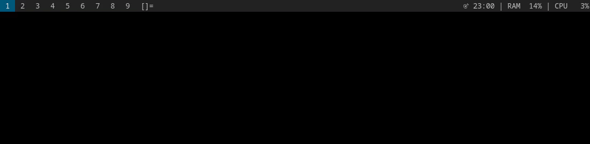
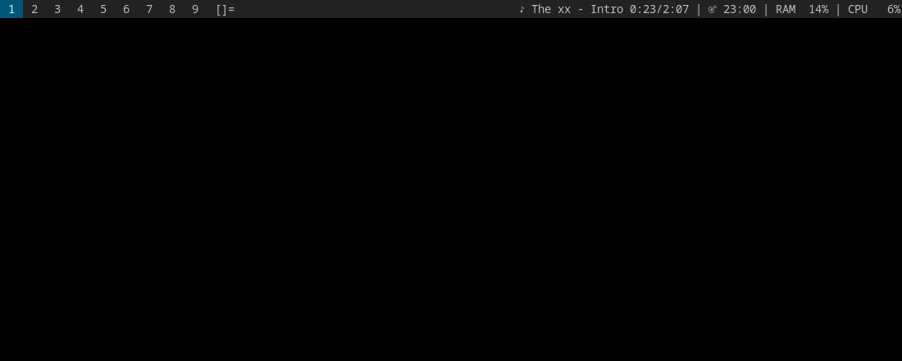
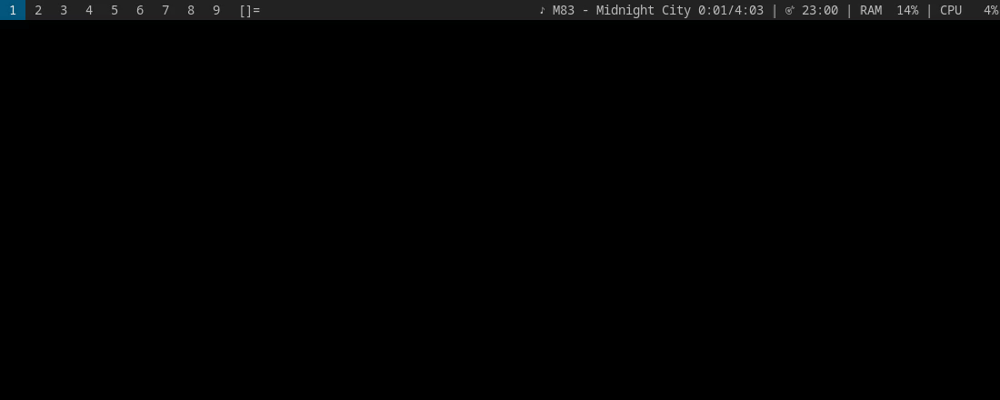
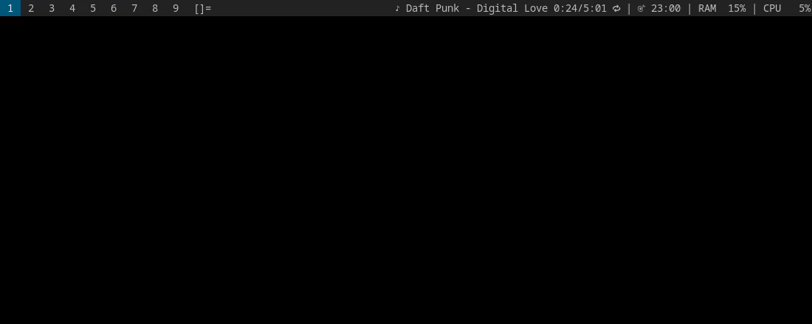
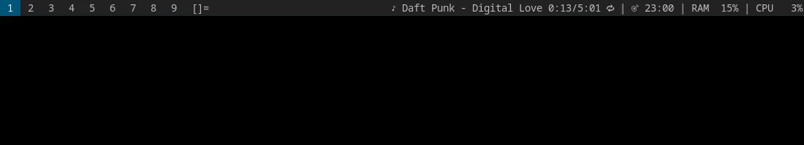

# spotify-menu

A dmenu frontend for Spotify that never shows the Spotify window. Play playlists, liked songs or anything you search for, all from one menu.

## Demo

The playlists and songs below are demo data.

**Playing a playlist**, the bar shows what's on



**Search**, by typing anything that isn't a menu entry



**Playback controls**, pause, next, repeat



**Like and add to playlist**



**Keyboard media keys**, play/pause, next and previous keep working



## Features

- Your playlists and liked songs, played or shuffled as a whole.
- Search for tracks, artists, albums and playlists, with your liked songs first.
- Pause, next, previous, shuffle and repeat.
- Like or unlike the current song, or add it to one of your playlists.
- Opens instantly from a cache that refreshes in the background.
- A notification while the hidden client starts up.

## How it works

| Part | Done with |
|---|---|
| Browsing and search | The Spotify Web API |
| Playback | The official Spotify client, hidden on a virtual display (Xvfb) |
| Controls and media keys | `playerctl` |

The Web API can't start playback on the desktop client, and Spotify refuses librespot based players like spotifyd for many accounts. That's why playback uses the hidden client.

## Install

| Needs | For |
|---|---|
| python 3.9+, dmenu | The menu |
| Spotify desktop client, logged in once | Playback |
| playerctl, xorg-server-xvfb | Controlling the hidden client |
| A Spotify developer app (needs Premium) | The Web API |
| dunst or libnotify | Notifications |
| xclip (optional) | Offering a copied client id |

**Create an app** at https://developer.spotify.com/dashboard. Select the Web API and add `http://127.0.0.1:8888/callback` as a redirect URI.

**Link the script.** The Python modules are found next to it.

```sh
ln -s "$PWD/spotify-menu" ~/.local/bin/spotify-menu
```

**Log in** by running `spotify-menu`. It asks for the client id and opens the browser. From a terminal:

```sh
spotify-menu login YOUR_CLIENT_ID
```

The token is saved in `~/.config/spotify-menu/` and refreshes itself.

## Usage

Run `spotify-menu`, ideally from a keybinding. Escape goes back a level.

| Entry | What it does |
|---|---|
| ⏯ ⏭ ⏮ | Pause/resume, next, previous |
| 🔀 Shuffle, 🔁 Repeat | Toggles shuffle, cycles repeat through off, all and one |
| ♡ Like / ♥ Unlike | Adds or removes the current song from your liked songs |
| ➕ Add to playlist | Adds the current song to one of your playlists |
| ⏹ Quit Spotify | Closes the hidden client |
| 🔍 Search, or just type | Searches Spotify |
| ♥ Liked songs | Play, shuffle or pick from your liked songs |
| 🔄 Refresh library | Fetches your playlists right away |
| A playlist name | Play, shuffle or pick a track |

Search results are marked ♥ your liked songs, ♪ tracks, 👤 artists, 💿 albums and 📃 playlists. Adding the artist helps, like "baby dijon" rather than "baby".

Good to know:
- ▶ Play resumes a playlist where you left off, like the Spotify app does.
- Picking one track plays only that track, since the client can't start a playlist at a given track.
- Spotify only lists the tracks of playlists you own or collaborate on.
- While the hidden client runs, opening Spotify normally shows no window. Quit the hidden one first.

## Tests

```sh
python3 -m unittest
```

The tests use your real account. They start the hidden client and play a few tracks for a couple of seconds each.

## License

MIT
